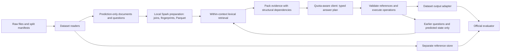

# Selected architecture and research proposal

Planning decision, 2026-11-06. No implementation or experimental results yet. See discovery.md for verified availability and research.md for sources. This document is the architecture of record; previous suggestions are not decisions.

## Research question

With one fixed language model and a fixed evidence-token budget, does selecting evidence together with its structural dependencies improve official answer scores and reduce wrong-operand errors compared with ordinary row/sentence retrieval and executable reasoning?

Here, structural dependencies mean the information needed to interpret a fact: row and column headers, ancestor headers, unit/scale labels, a cell's linked passage, or the source of a previously predicted conversational value. The hypothesis is strongest for ambiguous years, repeated row labels, hierarchical tables, linked-text hops, and hypothetical changes. HybridQA is a general-domain transfer check, not evidence of financial arithmetic performance.

Proposed contribution: a deterministic, budgeted evidence packer that keeps these dependencies with selected evidence, plus a controlled six-dataset evaluation. Call this **dependency-preserving evidence packing** in the report. This is a focused engineering/research hypothesis, not a claim to invent retrieval, structured evidence, program execution, or counterfactual reasoning. Provenance-bound operations make errors inspectable; their separate benefit must be isolated experimentally.

## Decision and alternatives

Use a shared API client with a zero-spend provider pool; freeze one instruction-following model within each controlled comparison block, with local parsing, lexical retrieval, evidence packing, and restricted program execution. Freeze the exact model revision, prompt, tokenizer/budget rule, and decoding settings before the final run. There is no joint training or separate dataset training in the main study. Dataset name selects only the reader, permitted input contract, output adapter, and evaluator; it must not select a model or reasoning prompt.

Considered alternatives: full-context direct answering is a useful baseline but cannot reliably retain large linked corpora in a small budget; six fine-tuned official architectures require incompatible environments and substantial training; iterative multi-agent retrieval adds cost and confounds the focused experiment. The selected approach retains essential capabilities with one model call per question and no trained router. Provider/model switching is quota-driven and logged, never chosen by answer correctness. Each controlled comparison block retains a fixed model; results across different models are reported separately.

## Data flow

Default scope is **supplied-context QA**: search only the supplied report excerpt/document, or HybridQA's assigned table and linked passages. Corpus-wide retrieval is a separate optional track that removes the supplied document identifier and measures document recall as well as answer scores. It does not replace or inflate the official QA track.

## Shared representations and leakage boundary

`PredictionExample`: dataset/version/split/ID, current question, allowed earlier questions, supplied context IDs. `Document`: ordered paragraphs with character offsets; tables with stable cell coordinates, original strings, spans/merged-cell geometry where available, explicit and inferred header paths; captions, links, unit mentions and their sources. An absent hierarchy remains absent; inferred structure carries an uncertainty flag. Preserve original HTML and raw strings alongside normalized values. No PDF/OCR reconstruction is needed for the supplied machine-readable benchmarks.

`EvidenceFact`: ID, document/table/row/column or paragraph offsets, raw content, parsed decimal value if applicable, scale, currency/dimension if known, header dependencies, linked IDs. Keep unknown units unknown. Do not collapse dollars, percentages, dates and counts into interchangeable numbers. Preserve parentheses-as-negative and distinguish a dash from zero.

`ReferenceRecord`: answers, scale labels, derivations/programs, evidence annotations, answer types, answer locations and relations derived from labels. It lives outside the inference object and retrieval index. Whitelist prediction fields per dataset; do not copy entire source records and remove a few known labels. TAT-HQA `rel_question`, `facts`, `mapping`, `if_op`, `if_tagging`, and gold `question_if_part` are not default prediction inputs. A question's explicit hypothetical clause is available and must be parsed from its own text.

ConvFinQA receives questions only through turn t, with a state ledger containing our earlier predictions and their evidence/program references. Never supply future questions, original FinQA source questions, gold prior answers or gold programs. Within a conversation, inference is sequential. Other conversations can run concurrently. To export cumulative official programs, retain and expand earlier predicted operation nodes; do not substitute reference intermediates. A questions-only/recompute-history setting is a useful comparison with the original workflow. Any teacher-forced history experiment is an explicitly labeled diagnostic, never the main result.

## Components: what, why, implementation, failure and test

| Component | Purpose and input → output | Proposed implementation / necessity | Main failures and contribution check |
|---|---|---|---|
| Readers and reference firewall | Raw dataset → prediction examples + separate labels | Six small modules; common validated schema, original IDs and split manifests. Required because a conversation, HTML table and linked Wikipedia table are different inputs. | Missing links, bad header inference, label leakage. Round-trip fixtures, exact count/ID checks; changing/deleting reference fields must leave serialized prediction inputs byte-identical. |
| Spark preparation and overlap audit | Prediction records → partitioned facts/documents/links + overlap reports | Local PySpark DataFrames for explode/join/deduplicate/fingerprint and Parquet writes; partition by dataset/split, retain source version. Stream through bounded batches; no API calls inside Spark tasks. | Small-file overhead, duplicated contexts, accidental train/test joins. Compare canonical output hashes with a plain Python preparation on the same records; time cold and warm runs. |
| Candidate retrieval | Question, allowed history, supplied facts → ranked candidate IDs | BM25-style lexical ranking over rows/cells with headers and sentences, plus exact entity/year matches; deterministic ties. For linked text, rank cell/link candidates and attached sentences. No learned embeddings in the main study. | Vocabulary mismatch and missing bridge facts. Measure gold evidence recall at fixed tokens where annotations exist; no gold evidence used for selection. |
| Dependency-preserving packer (main intervention) | Candidate IDs + dependency edges + token cap → evidence bundle | Greedily admit candidates in rank order only with required headers/unit labels/link anchors; deduplicate shared dependencies. A selected linked sentence includes its originating cell and headers. Header closure is recursive; passage expansion is bounded and question-ranked, not all linked text. Include selected prior values with provenance. | Closure consumes budget and displaces needed facts; incorrectly inferred dependencies. Compare with ordinary ranked packing and length-matched neighboring-context expansion. Log seeds, added nodes, dropped nodes, truncation and actual token counts. |
| Shared answer planner | Question + evidence + permitted state → structured answer plan | Same frozen model/prompt and operation menu for all datasets. Model chooses extract, multi-span, count, arithmetic, comparison/argmax or hypothetical overlay based on question/evidence. One JSON output with references, operations, answer scale and status. | Wrong operand/operation, malformed JSON, domain misunderstanding. Equal-model direct baseline; cached replay; manually inspect errors without altering test prompts. |
| Validator and executor | Typed plan + evidence → answer, trace, status | Small allowlisted interpreter, not unrestricted Python `eval`. References resolve to actual cells/spans, question literals or earlier predictions; arithmetic constants such as 1 and 100 are explicit. Decimal arithmetic, bounded exponent/step count; sum/mean/min/max/count/comparison/argmax/select and ordered arithmetic. | Division by zero, unit mismatch, invalid IDs, omitted operand or wrong target. Semantic tests plus comparison with official evaluator arithmetic; distinguish executable from correct. Reject ungrounded literals; record unknown-unit warnings without declaring semantic correctness. |
| Hypothetical overlay within executor | Question-grounded intervention plan → temporary changed facts → normal operations | Replace/add/subtract/multiply/percent-change a referenced fact in a copy-on-write view, then run the same answer operations. Base facts remain available with IDs. Needed for TAT-HQA; not a separate model. | Wrong intervention scope, confusing percentage points with percent change. Paired factual/hypothetical fixtures and overlay-removal diagnostic. Do not feed the related factual answer. |
| Output adapters/evaluators | Answer + predicted plan → official prediction format + metrics | FinQA/ConvFinQA operation-token compiler, TAT answer/scale map, HybridQA span string, MultiHiertt span/program union. Pinned evaluator code runs only after inference. | Invalid tokenization, scale changes, incomplete IDs, evaluator bugs. Contract fixtures and missing/duplicate checks; invalid/abstained answers count as failures in full denominators. |
| Run ledger/cache | Config + request → resumable predictions and resource logs | JSONL/SQLite request ledger and immutable run manifests, request hashes, explicit completed/failed status; append each result atomically. | Duplicate billing, silent retry changes, cache mixing variants. Interrupt/resume and cache-key tests; compare resumed output with uninterrupted cached replay. |

The packer uses a small adjacency list, not a graph database or graph neural network. Table data are never destroyed by flattening; only the evidence view is serialized. For short documents that fit, admit all content with structure and report that retrieval cannot improve their coverage. The baseline receives readable headers too: deliberately removing essential labels would create an unfairly weak comparator.

The initial model call has no semantic self-repair loop. A deterministic JSON parser may remove surrounding code fences but must not invent missing fields. Failed validation produces a recorded failure. A later one-repair-call study is optional and must compare both systems at matched call/cost budgets.

Output compilation must cover ConvFinQA's official single-number program form as well as composed operations; do not synthesize an arbitrary identity operation and assume program equivalence. Dates/booleans/span lists stay typed until the dataset adapter. Freeze shared prompt examples, initially zero-shot, rather than tuning a separate demonstration set per dataset. Temperature zero does not guarantee hosted-model determinism; retain raw responses and repeat a small fixed sample only if the budget permits measuring variation.

## Laptop feasibility and operating budget

Verified visible resources: 8 logical CPUs, ~47 GiB RAM (~45 GiB available), ~922 GiB free on the WSL virtual filesystem. GPU inaccessible to both NVML and PyTorch. Physical Windows free disk and GPU capacity are not independently verified. Plan for CPU data processing + hosted model inference, with no dependency on GPU repair. The user's 64 GB/RTX 4060 8 GB description remains a host claim.

All following allocations/timings are estimates or limits, not measured performance:

| Work | Initial allocation / estimate | Measurement or decision gate |
|---|---|---|
| Local preparation | Spark `local[4]`, driver 4 GiB, 8 shuffle partitions; Python process target ≤4 GiB; total process-tree RSS target ≤12 GiB | Inspect real peak RSS including JVM and children, spill bytes, cold start and steady-state time. Sequential Python may win; report that honestly. |
| Data storage | Existing six repositories ~0.4 GiB including Git; reserve 5–15 GiB for missing corpora/derived data, 1–5 GiB for requests/logs; no vector database | Unknown downloaded corpus size must be checked first. Hash and reuse contexts instead of copying them per question. |
| API inference | Start concurrency 2, cap 4 only if permitted; 1 question/request, conversations serial; 4k evidence tokens + ~1k instructions/history and ≤600 output tokens as initial assumptions | Actual tokenizer counts must include history and any billed reasoning tokens. Tune budget only on development data. |
| Optional local inference | A quantized 3B model: 1.5 GB theoretical 4-bit weights plus quantization/runtime/KV overhead, budget 4–8 GiB RAM; a 7B model: 3.5 GB raw weights and perhaps 8–16 GiB total host RAM | No suitable inference runtime/model cached. CPU speed/quality unmeasured. An 8 GB GPU, even if restored, does not guarantee 7B fits at chosen context length. Benchmark 10 requests before commitment. |
| Training | None in main plan | Later small adapter training only after overlap audit, GPU validation and a new time budget; same joint model across all data with dataset balancing, not six models. Not required for this contribution. |

Cost formula: `N × variants × (1 + retry_fraction) × (input_tokens × input_price + output_tokens × output_price) / 1,000,000`, plus any provider-specific cached/reasoning charges. No provider prices have been assumed or paid calls made. The user has now set a zero-spend policy: the paid-price scenarios below are sensitivity illustrations only, not authorized spending.

Illustration only: 600 questions × 3 variants × 1.05 attempts, at 5,000 input and 600 output tokens, means 9.45M input and 1.134M output tokens. Hypothetical rates $0.20/$0.80 per million would cost $2.80; hypothetical $2/$8 rates cost $27.97. These are scenarios, not quotations. For 6,000 questions, multiply by ten. A first 20-question, two-variant pilot at the same assumptions is 0.21M input/0.0252M output tokens: $0.06–$0.62 under those illustrative rates.

At an assumed 10–30 seconds/request and concurrency 2, 1,890 attempts take roughly 2.6–7.9 hours, before provider throttling; conversation serialization may increase time. CPU generation at an assumed 5–20 tokens/second takes 30–120 seconds just for 600 output tokens, excluding prompt processing: 1,800 sequential calls would take 15–60 hours. Measure, do not promise these speeds.

Preparation estimate: if the acquired raw corpus is 1–5 GB and effective parse throughput is 2–20 MB/s, pure parse time is ~1–42 minutes, plus Spark startup, indexing and writes. Run a 1% pilot and extrapolate with uncertainty instead of adopting this as a schedule.

Use content-addressed request keys including model revision, prompt, schema, packer, raw-data hashes, question, history and decoding settings. Cache raw responses as well as parsed results. Re-evaluate/export cached outputs without calling a model. The dollar ceiling is $0; enable only verified free endpoints or confirmed credits with controls preventing paid spillover. Reserve 20% of available request/token quota for failures. Retry transport/429/5xx at most twice (3 attempts total), exponential backoff with jitter and `Retry-After`, bounded 60-second request timeout; do not retry schema failures for free. Record ambiguous timed-out requests because the provider may have billed them. Provider-side idempotency, if supported, reduces duplicates.

The user confirmed a deadline of **8 November 2026** (time unspecified), giving roughly two calendar days from this inspection. Full six-dataset reproduction, missing-corpus recovery, several ablations and full test evaluation still exceed a defensible guaranteed scope. Keep this architecture, but prioritize a small complete vertical slice, then all-reader coverage, then a paired validation pilot. Full six-dataset scores are an expansion goal conditional on data, API access and elapsed time. Unsupported datasets must be explicitly marked blocked, not replaced with mock results. No score target is promised.

Spark/Hadoop are optional according to the user's clarification. Keep Spark's bounded, measurable preparation/overlap task, but use the equivalent Python path for tiny debugging runs and production if it is faster. Do not spend the deadline deploying HDFS: introduce it only if later corpus size or distributed storage needs justify it. Report Spark's measured benefit or overhead rather than treating its presence as a contribution.

## Free API pool and quota switching (user decision, 2026-11-06)

Candidates supplied by the user: Gemini, OpenAI lower-cost GPT models if genuinely free to the account, OpenRouter, Groq and Mistral. Exact models, free eligibility, limits, reset times and priority order remain unverified. A provider name or API key alone does not prove zero-cost access. No automatic top-ups, paid endpoints, paid tools or billable overflow. If zero spend cannot be enforced for a candidate, leave it disabled. Never assume a provider's automatic model router preserves model identity.

Use one provider registry (`configs/providers.yaml`) and one client interface, not five reasoning systems. Each entry records provider, endpoint, exact model/version, context limit, structured-output support, free-access basis, requests/minute/day, tokens/minute/day, reset times and cooldown state. Secrets belong in environment variables, not this file or report. Cache keys include provider and exact resolved model as well as the existing request fields. Use the same operation schema and semantic prompt across providers; only transport/format handling varies. Start concurrency 1 per provider, bounded by verified limits; the earlier concurrency-2 estimates are conditional scenarios.

Scheduling rule: check local request/token budgets before dispatch. On transient rate limiting, respect Retry-After and cool down that provider; dispatch eligible work to another verified free provider. On exhausted daily/free-credit quota, disable until the known reset or confirmed replenishment. Authentication failures disable the entry; invalid requests or wrong answers are not reasons to search for another model. At most three transport attempts total per logical request, across all providers, to avoid retry amplification. If every provider is unavailable, checkpoint and wait for a reset; never switch to paid access. No model calls occur during planning.

For fair experiments, the scheduling unit is a matched block: the same example and all compared variants on the same provider/model, with order counterbalanced. For ConvFinQA it is an entire conversation for each variant, each using its own predicted history. Estimate/reserve enough quota before starting a block. If quota still expires midway, cache the completed outputs and mark the block incomplete; move fresh blocks to another provider. Resume the incomplete block on its original model after reset, or rerun all its variants on one replacement model under a new block ID. Do not combine a baseline from one model with the proposed method from another. A cached old-model response cannot fulfill a replacement-model request.

Prefer a small single-model confirmatory subset shared across all available datasets. For larger free-pool runs, assign shuffled blocks without using labels/outcomes, log provider/model per prediction, and report paired effects by model and dataset. A pooled mixed-model result is explicitly the quota-routing policy's result, not a fixed-model benchmark. Save assigned, completed and incomplete counts so quota attrition cannot disappear from the report. Live/demo inference can switch immediately, logging model provenance, but its outputs are not silently substituted into controlled experiments.

Zero spend does not mean unlimited throughput. With V variants and a verified request allowance Q, at most floor(Q/V) complete single-question blocks fit before retries; also enforce token budgets and conversation size. For example, a hypothetical 50 requests/day permits at most 25 two-variant questions before reserves, irrespective of inference speed. Recalculate attainable sample size from actual account quotas before committing to the 600-question study. Caching and smaller paired samples take priority over switching through many untested models.
